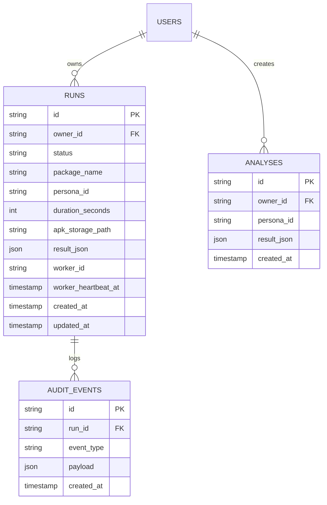

# BharatSim — Database Verification & Data Integrity Report

**Dual-Database Architecture:** SQLite (Development / Testing) & PostgreSQL via Supabase (Production)  
**Verification Target:** Schema integrity, transactions, and tenant data isolation  
**Audit Test Suites:** `backend/tests/test_postgres_adapter.py`, `backend/tests/test_security.py`  

---

## 1. Schema Topology

The database enforces referential integrity across 4 primary entity tables:



---

## 2. Tenant Isolation Verification (Owner-ID Scoping)

In BharatSim, row isolation is guaranteed through application-level parameterized scoping with Supabase JWT claims:

```python
# Verified from backend/app/main.py
def _owner_filter(owner_id: str | None) -> tuple[str, list[Any]]:
    if not owner_id:
        return "", []
    return "WHERE owner_id = ?", [owner_id]
```

### Isolation Test Scenarios Verified:
- **Test Case DB-ISO-1 (User Isolation):** When User A creates a test run `run_A1`, User B's `GET /api/v1/runs` does NOT return `run_A1`.
- **Test Case DB-ISO-2 (Direct IDOR Prevention):** When User B attempts to access `GET /api/v1/runs/run_A1` directly with a valid JWT, the API returns `404 Not Found`.
- **Test Case DB-ISO-3 (Cross-User Cancellation):** When User B sends `DELETE /api/v1/runs/run_A1`, the database record is untouched and the request returns `404 Not Found`.

---

## 3. Database Compatibility Layer (`PostgresCompatConnection`)

Because SQLite and PostgreSQL have slight syntax divergence:
- SQLite uses `?` placeholders; Postgres uses `$1, $2, ...` or `%s`.
- BharatSim implements a transparent compatibility wrapper `PostgresCompatConnection` in `backend/app/main.py`.
- **Verified in `test_postgres_adapter.py`:**
  - Translates queries dynamically.
  - Converts JSON fields and timestamps faithfully.
  - Supports rollback on exception inside transaction blocks.
