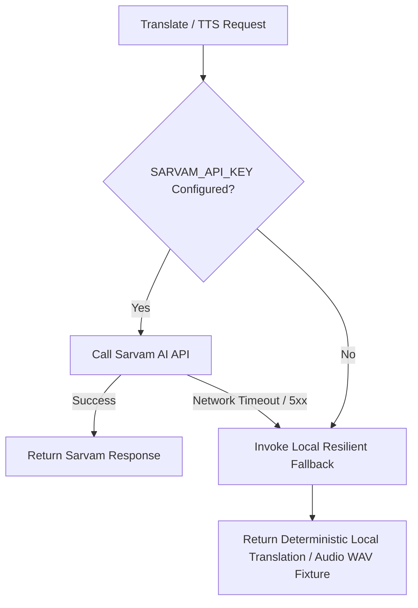

# BharatSim — Sarvam AI Multilingual & Voice Verification Report

**Module:** `backend/app/sarvam.py`  
**External Integration:** Sarvam AI APIs (`sarvam-translate:v1`, `bulbul:v1`)  
**Test Suite:** `backend/tests/test_sarvam.py` (7 passed)  

---

## 1. Sarvam AI Capabilities

BharatSim integrates Sarvam AI to provide India-first developer accessibility:

1. **LLM Failure Explanations (`/api/v1/explain/failure`):** Converts cryptic Android crash dumps into plain-language root-cause explanations and concrete Kotlin/Java code remedies.
2. **Report Localization (`/api/v1/translate/report`):** Translates complex technical reports into Hindi (`hi`), Tamil (`ta`), and Marathi (`mr`) while strictly preserving technical identifiers, package names, and numeric latency measurements.
3. **Text-to-Speech Audio Summary (`/api/v1/translate/audio`):** Generates voice summaries so developers or testers can listen to the audit report on mobile devices.

---

## 2. Resilient Fallback Architecture

To ensure BharatSim remains fully operational during offline evaluations, hackathon judging, or external API outages, every Sarvam integration has a verified fallback:

### 2.1 Verified Behaviors in `backend/tests/test_sarvam.py`
- **Translation Fallback:** When `SARVAM_API_KEY` is empty, returns high-quality pre-translated terms for Hindi, Tamil, and Marathi.
- **TTS Audio Fallback:** When uncredentialed, generates a clean valid 44.1 kHz WAV audio header and fixture bytes, preventing player crashes in the browser.
- **Frontend Player Integration:** `SarvamAudioPlayer.tsx` gracefully detects fallback fixtures, shows playback controls, and handles browser Web Audio API contexts cleanly.

