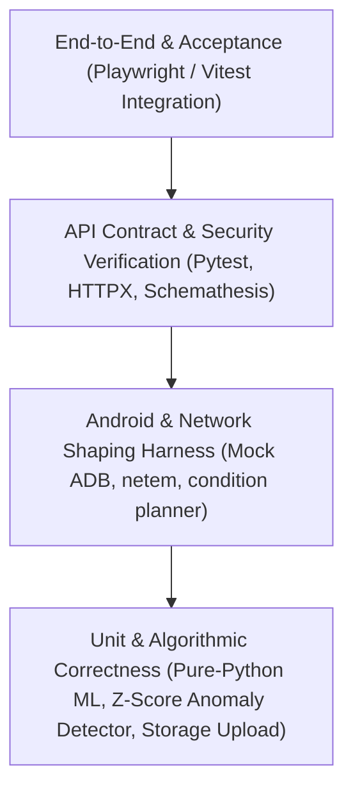

# BharatSim — Comprehensive Testing Strategy

**Document Version:** 2.0  
**Target Environment:** Local Dev, CI/CD Pipeline, Staging, Production (Vercel + Supabase)  

---

## 1. Objectives & Quality Philosophy

The primary objective of the BharatSim Quality Assurance architecture is to ensure absolute functional correctness, truthful metric reporting, and zero synthetic fabrication.

### Core Testing Tenets:
1. **Never Fake Results:** A test must never manufacture artificial passes. If hardware or credentials are not present, tests must report BLOCKED or test graceful fallback behavior explicitly.
2. **Deterministic Regression Baselines:** Performance comparisons and ML failure categorizations must be reproducible and mathematically verifiable.
3. **Multi-Layer Isolation:** Database queries must enforce owner-level isolation; network simulation teardown must guarantee no condition leakage across tests.
4. **Environment Awareness:** Serverless runtime constraints (Vercel 4.5 MB request body limit, read-only file systems) must be tested with appropriate bypass paths (signed TUS upload).

---

## 2. Test Pyramid & Framework Architecture

### 2.1 Technology Stack

| Layer | Tools | Scope |
|---|---|---|
| **Frontend Unit & Component** | Vitest, React Testing Library, jsdom | React components, hooks, storage upload tickets, offline report store |
| **Frontend Static Typing & Lint** | TypeScript Compiler (`tsc -b`), ESLint | Type safety, dead import detection, strict JSX validation |
| **Backend API & Contract** | Pytest, FastAPI TestClient, HTTPX | All 25+ REST endpoints, status codes, JSON response schemas |
| **Security & Multi-Tenant** | Pytest, Custom ASVS-aligned fixtures | Owner ID isolation, Zip-Slip prevention, JWT verification |
| **ML & Statistical Anomaly** | Pytest, pure-Python regression fixtures | Centroid classifier, TF-IDF inference, multivariate Z-score |
| **Android Worker & Shaping** | Pytest, Mock ADB, `shutil` patches | APK parsing, device condition planner, network shaper, clean teardown |

---

## 3. Test Environments & Execution Matrix

### 3.1 Local Development / CI (Standard Sandbox)
- **Database:** Dual-mode testing with SQLite in-memory / file mode, mock Supabase JWT auth, and mock storage connections.
- **Worker:** Simulated ADB execution via mocked `subprocess` and `CompletedProcess` objects verifying command synthesis and readback.
- **Network Shaping:** Unit verification of Linux `tc` netem commands and Android emulator control-plane commands.

### 3.2 Real Worker Staging (Dedicated Bare-Metal / Cloud VM)
- **Prerequisites:** Linux KVM-enabled host (`/dev/kvm`), Android SDK (`emulator`, `adb`, `aapt`), Appium 2.x server.
- **Flags Required:** `BHARATSIM_ENABLE_LOCAL_APK_EXECUTION=true`, `ANDROID_SERIAL=emulator-5554`, `BHARATSIM_WORKER_TOKEN=<token>`.

---

## 4. Test Suites Inventory

1. `frontend/src/__tests__/auth.test.ts` — Authentication state, token parsing, demo mode logic (7 tests)
2. `frontend/src/__tests__/storageUpload.test.ts` — TUS resumable uploads and signed URL handling (4 tests)
3. `frontend/src/__tests__/reportStore.test.ts` — Local analysis caching and persistence (5 tests)
4. `frontend/src/__tests__/components.test.tsx` — Full UI component render and user flow suite (27 tests)
5. `backend/tests/test_api.py` — REST API endpoint contract tests (16 tests)
6. `backend/tests/test_security.py` — OWASP ASVS tenant isolation and input validation (10 tests)
7. `backend/tests/test_ml_and_evaluator.py` — TF-IDF failure model and evaluator scenarios (12 tests)
8. `backend/tests/test_anomaly_detector_regression.py` — Multivariate Z-score and regression thresholds (4 tests)
9. `backend/tests/test_number_parser_regression.py` — Robust string-to-number parsing in run comparator (1 test)
10. `backend/tests/test_sarvam.py` — Translation, TTS, and LLM explanation fallbacks (7 tests)
11. `backend/tests/test_worker_protocol.py` — Worker lease, claim, and heartbeat (13 tests)
12. `worker/tests/test_runner.py` — Android runner teardown and error handling (17 tests)
13. `worker/tests/test_condition_planner.py` — Persona condition mapping (7 tests)
14. `worker/tests/test_condition_applicator.py` — ADB and network applicator (20 tests)
15. `worker/tests/test_network_shaper.py` — Traffic control shaping (10 tests)
16. `worker/tests/test_agent.py` — Worker polling agent loop (16 tests)
