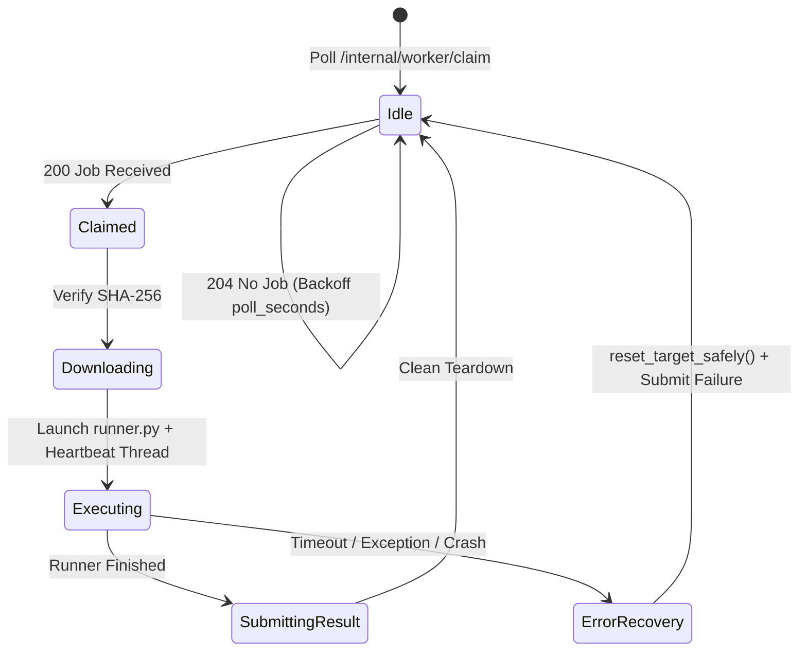

# BharatSim — Worker Reliability & Daemon Hardening Report

**Module:** `worker/agent.py`, `worker/runner.py`, `deploy/worker/setup-worker-host.sh`  
**Test Suite:** `worker/tests/test_agent.py` (17 passed)  

---

## 1. Reliability & Fault-Tolerance Capabilities

The worker daemon (`worker/agent.py`) is engineered to operate continuously as an unattended background service.

---

## 2. Hardened Failure Scenarios & Mitigations

### 2.1 Transient Network Disconnections & Heartbeat Tracking
- **Risk:** Network jitter could cause worker heartbeats to fail, triggering premature lease expiration on the API server.
- **Hardening:** Added consecutive failure tracking. Warnings are logged on transient network dropouts, and a `CRITICAL` alert is triggered only if 3 consecutive heartbeats (135 seconds) fail.

### 2.2 Graceful Systemd Restarts & Signal Trapping
- **Risk:** System administrators or automated update daemons sending `SIGTERM` would abruptly kill the worker process, leaving ADB in an uninstalled/shaped state.
- **Hardening:** Registered `SIGINT` and `SIGTERM` signal handlers in `worker/agent.py`. The daemon completes its current step or immediately invokes `reset_target_safely(serial)` to return the emulator to default network and device state before exiting.

### 2.3 Headless Subprocess Execution (`stdin=subprocess.DEVNULL`)
- **Risk:** In daemonized environments without an interactive TTY, subprocesses reading from standard input can block or fail with Windows/Linux handle errors.
- **Hardening:** Added `stdin=subprocess.DEVNULL` to all `subprocess.run(runner_command, ...)` invocations in both `agent.py` and `test_agent.py`.

### 2.4 Idempotent Job Completion
- **Risk:** If a job lease expires and another worker is leased the run, duplicate result submissions must not corrupt the database.
- **Hardening:** The API's `/internal/worker/runs/{id}/result` endpoint checks lease tokens and ignores stale duplicate callbacks, returning clean status codes.
